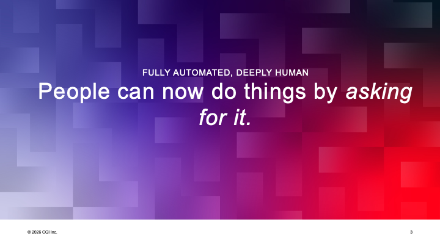
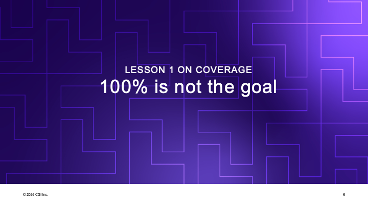
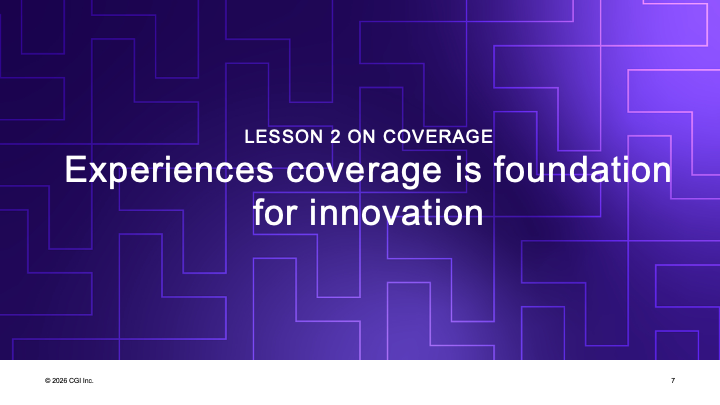
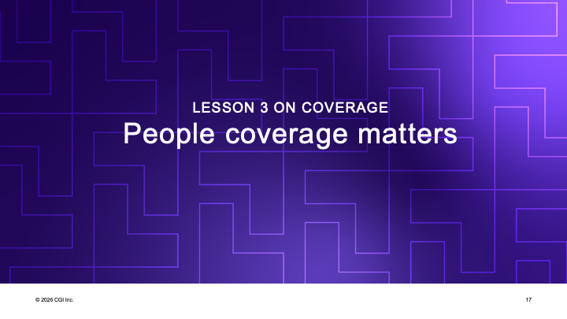

# Increase Personal AI Coverage

### AI Native journey

_Presented: CGI Alignment 2026, November 2026_
_Keywords: coverage, ai, ainative, testing, qualityengineering, aitransformation, propertybasedtesting_

We keep talking about testing, but we can't talk about testing without talking about coverage. When I started as a tester, almost 30 years ago, coverage always meant one of two things. Either it was requirements - the authoritative source, somebody else's right answers that we would check against - or it was code: did we touch all the things that were implemented? We used the requirements to cover what might still be missing from the code, and the code to see we had our eyes on everything that had been implemented. That has worked for 30 years, and it still works. Those are great approximations.

But as testers get older, we get to take the core lessons we learned early, like coverage, and apply them to things nobody thought coverage was relevant for. AI transformation is a coverage question. Have we taught every single one of our people how to do certain things with AI? That's coverage. How testing is being done is coverage. A lot of the conversations about getting everyone on board in major transformational changes are actually coverage questions. And thinking of things as coverage - creating lists of things we want to track - is probably a core thing for us as testers to bring.

I have three lessons. Instead of telling a story and arriving at the lesson, I start each section with the lesson and end it with the same one.

Growth was always the goal. 100% never was. I want to use AI and testing to show what I mean.

One of the things AI brought to my tester life is that whatever I can imagine getting a computer to do, I can now do. Five years ago I couldn't. I had to rely on a poor proxy called good relationships with developers - if I had a good relationship with someone who could do what I couldn't, I could go and talk to them. Cake was my main armor. I would organize parties, facilitate meetups, bring the best people in the world to teach us, all to get people to move in the direction I wanted. I no longer need to do all of that. I can go to the assistant and ask for whatever I can imagine. Now I'm limited by my imagination of what to ask.

Here's what asking for testing might look like. Raster reveal is a little exercise by James Lyndsay at Workroom Productions: you start with a vague grey box with a picture hidden in it, and as you move your mouse, the picture gets clearer and clearer. It reminds me a lot of testing. I still need to know how to ask in a particular way to get what I want - if I don't tell it to use playwright-cli, it tries to take a screenshot or go under the hood instead of doing what I meant. But once I know how to ask, I get it.

I've enjoyed this as a manual exercise a lot. It's fun to scratch away in one corner and say: believe me, there's a dog in this picture. I've spent an hour testing this now. And you still can't see anything, because I spent all my so-called testing time on a corner that doesn't reveal any of the shapes that matter. You can't say I wasn't testing - I was spending time, I was doing testing. The only way to improve that communication is to start talking about coverage: where in this two-dimensional picture am I actually moving? And when things are more complicated than a raster reveal, it gets even harder to talk about what it means to ask something, or someone, to do testing.

![Four timestamped frames of the AI-driven raster reveal: at 0:00 it confirms a quadtree revealing finer detail where the cursor crosses and plans a top-to-bottom sweep; at 0:46 "a dark animal-like shape is emerging on a light background, with orange/gold accents"; at 3:12 "that's unmistakably a black rubber duck with an orange beak and a gold Batman bat-symbol"; at 13:26 the final identification stands, with the original Unsplash source "DC Batman duck toy" found - under "Avoid confidently incorrect judgement"](./EN_202611_increase_personal_ai_coverage/Slide5.png)

I asked the AI to leave behind timestamps so I could compare. I expected it to be quick enough that I didn't go do anything else useful in the meantime, so I didn't save any time by automating it - but I was curious. At 46 seconds, it was convinced there's a dark animal-like shape, without calling out what. I hadn't told it a strategy, so it picked one for me. At 3 minutes 12 seconds it announced - very AI thing to say - that it is _unmistakably_ a rubber duck. And it took 13 minutes 26 seconds before it said it's all revealed now.

As a human, I would have scratched the right parts and known what's in the picture in less than 46 seconds. And at 13 minutes I'd have given up and had a couple of cups of coffee instead. When given a hint that the image is on Unsplash, it also found the original source, and that's when you're certain. Until then it might still be a confidently incorrect judgment - maybe you don't know what Batman is.

So 100% is not the target. More than zero is the target. Whenever we have conversations about how fast or how long, with or without AI, we need to have the conversation about how far we are supposed to get in that time. 100% cannot be done. There are compliance areas where we need to pretend we got to some level of 100%, but it's 100% from a particular angle that someone defined - and hopefully we take a second perspective too, to find the results that technique misses. What we need is to be able to ask for something other than "please test this for me".

If we don't have versatile experiences with AI, we won't have great ideas of what we could ask for. Our imagination would be very limited. Experience coverage is the foundation for any innovation.

![A grid titled "AI-native journey: individual experiences by role" - 30 experiences people grow into: 12 for the knowledge worker role (external imagination, local and online summarizing, integrated AI features in domain tools, AI-enabled practices, task expansion, personal applications, 2nd brain, token awareness, generating artifacts, pitch to project for AI usecase, mentioned in CV) and 18 more for the developer role (code autocomplete, reactive and proactive agentic, configuring and building MCPs, integrating AI system components, skills and git-first templates, local models, dark factory, spec-driven development, team/product context, delivering AI native projects and product AI features, sandboxing). For testers: 90% of the experiences covered by someone, 35% by everyone. "An experience counts when you can tell its story."](./EN_202611_increase_personal_ai_coverage/Slide8.png)

Over the last year I built a coverage metric: 30 categories of AI-related experiences, 12 for knowledge workers and 18 more for builders. I talked to about 50 of my colleagues at CGI, and last week I had about ten people seeking employment write an essay on their experiences. In our organization, among the people I categorized as testers, 90% of the categories are covered by _someone_ - there are still some none of us in testing have done. For _everyone_ having the experience, it drops to 35%. And from the latest ten essays I found two new categories I couldn't fit on my slides anymore. Again, 100% is not the goal, growth is. Turning "do you use AI, yes or no" into something more fine-grained is very much a tester thing to do.

One of the rare experiences is the second brain. When I asked the room, four or five people knew what it is. It's one of the lowest-hanging bars in the use of AI, and yet most of us don't have that experience. The idea, from Andrej Karpathy, is that you use AI together with a vast source of material to curate the smaller set of things you actually want. Clearly I had a conversation with one colleague and another with a different colleague, and we made agreements that are completely opposite - AI would notice that, just from having those conversations available as text. That feels like the foundation of so much of what we do in testing: finding the conflicts between the requirements and the actual conversations, the examples we share in the hallways. Some people want to turn that into test cases. I'd like to believe we want to turn it into actual results. I don't care about the test cases; I care about finding the things we need to react to.

Part of why we don't have this experience is that following all the good advice in the world isn't possible. The bigger part is that most of us are equipped with knowledge worker AI tools rather than builder AI tools. Many people in the room use ChatGPT or a similar chat; far fewer use Codex, which comes out of the same box. That's the reason we don't have second brains. The sandboxed chat versions tell you they handle 40 input documents at a time. A second brain shines when you give it, for example, 16 years of your public notes on Twitter, LinkedIn and Mastodon, and it tells you every place where you changed your mind without noticing - and should probably apologize to the people you taught over those years.

There's plenty more on the builder side. Local models, for example: usually my computer is listening to me talk with a local model, so not all of my conversations go to the cloud. Talking is sometimes the best way for me to track my ideas and have AI process them. And if you have things you can't share because they're your customers' secrets, you can still talk about them with a local AI when nothing goes to a cloud. These are tools already available to us.

I can't go through all 30 in one talk, so I'm planning a social media series with an example of each - out of 50 people, there are many great stories of how people actually use these. The tracker that explains each experience is published at [qe-at-cgi-fi.github.io/ai-journey](https://qe-at-cgi-fi.github.io/ai-journey), as part of CGI's open source QA repo. Even the agent that analyzes your CV and essay and gives you a score is there - you need GitHub Copilot, Codex or Claude Code, any of the programming-oriented tools, and it gives you the same feedback it would give me. You have an idea of coverage in your head - maybe tasks, maybe your learning, maybe something else - and with vibe-coded personal apps you can turn what's in your head into something others can use much more easily.

The list wasn't 30 things in the beginning. It started as a road. On one side were people able to move forward and go anywhere they wanted. On the other were people explaining their roadblocks. The first roadblock: clients don't give us permission to use any AI tools. But you can use local tools, and not all of your work is client secrets - some of it is making sense of what testing is and why we're doing it. The second: no client artifacts, nothing from Jira, no code. One by one, we've been getting over these hurdles for the last years.

The third still feels like the biggest: test data and the application you can't allow AI to operate. If you can imagine it, you can ask for it - but only if you have permission to operate the data. If you don't, you need to know how to do the parts of the work you still can with AI's help, which means being even more creative. Even masked test data, without personal names, tells a lot about an organization's business rules. I'm not sure all Finnish companies would ever be ready to give OpenAI or Anthropic access even to pseudonymized data. Until we can fully fake the data, these limitations will hold on the testing side, and we know we need to make them hold. Some roadblocks are real and relevant. If you can remove all of them, you can get remarkably far, even as a non-programmer - to armies of agents taking care of things for you, to dark factories where you're away for the night and still have something in the morning. But that requires more access. On our road, we might need to go slower, and there are still so many things to try and learn.

![A diagram titled "From doubtful intent to learning at the center": on the requirements end, "Living common ground" - converse with the people who hold the intent, ingest conversations into an LLM wiki, facilitate deepening the aspects that matter; on the testing end, "Quality feedback slices" - properties that must hold across every input, core examples built up from the acceptance factory, model reconciliation of our model vs. the system; in the middle, "Build a slice of value - Learning: agents build, people validate, we decide what ships", with "Doubtful intent - Intent Lead sets the bar" above, and core examples growing from the living common ground into every feedback slice](./EN_202611_increase_personal_ai_coverage/Slide10.png)

In practice, what I'm doing with AI in testing goes in two directions. One is the requirements end. On a project from April until now, I learned in three stages. In the first stage, we created with AI assistance a requirements specification - 80 pages, 60% of the effort. It felt successful until the rubber met the road: when development started, very little of it was useful for development. In the second stage, development created its own context - about two pages of architectural guidelines - and threw away most of what we'd written in the so-called requirements and technical specification. Building incrementally, we generated quite a lovely system: a UI, two APIs, all deployed in the cloud. That felt like a success until the third stage, where we needed to put the beginning and the end together without creating isolated bubbles. That's where the second brain approach came in: living common ground. Every conversation feeds a wiki, which feeds whatever goes into the context.

The other direction, and the one I'm most excited about, is quality feedback slices: an agent that knows how to make certain moves. Fewer than ten people in the room had ever tested accessibility. An accessibility agent that tells you what the problems are, why they're problems, and gives you nice summarized agentic views into your system using the source code and the running application - that does a better job than not doing it at all. Again, more than 0% is our goal. Many of these I didn't build; I found them in the world, where the community is a nice one. Curating the world is where I usually find myself spending time.

Even more interesting in the last couple of weeks has been property-based testing - anyone who follows me on socials knows I'm excited about it to the level of obsession. For the last few conferences and customer meetings about testing, I've spent five minutes asking AI to find problems on the website or service of that customer or conference, and I've shown up with a list of real production problems, at least one of which they would never have wanted in production. I use the Antithesis research skill to identify properties, and then ask AI to put those properties together with our test automation, so the automation looks for things that should always be true and that it wasn't looking for before. A really powerful way of using AI.

What ties these two directions together is intent, framed in a doubtful way: this might work, or it might not. Remembering that more than 0% is the goal, rather than full certainty. In a year I'll have a different list, but these are likely to stay on it.

![A test process titled "Automation is documentation", in four columns: 1 First, Collaborate - start with enablers like budget, test environment and people, the things that move slowly; risk-based sampling of reviews; build a risk register and core examples in living common ground. 2 Right after, Automate - the documentation: when you test, first ask for bugs through quality slices; pair to fix bugs, leaving behind architecture-aware automation, red to green to pull request; model the APIs and UIs to increase automation coverage; ensure core examples are included and reported green. 3 Then, Explore - spend time using the application, report bugs by fixing them. 4 Last, Test cases - publish the list of test cases for review and conversation, generated primarily from the automation. All along: collect product risks to drive risk-based quality slices, and improve bug fix decision-making rules](./EN_202611_increase_personal_ai_coverage/Slide11.png)

I use these in real projects. This Monday, we talked about how developers can now do things four times faster - a random number somebody generated - and whether testing will be four times faster too. We're already faster at generating scenarios: AI can write them, but people still need to go through them, so overall that's not four times faster. So what does it look like when you actually try to make testing faster? Here's what it looked like on my project over the last six months.

First, you collaborate. (The question coverage in the room wasn't great at this point, by the way. 100% isn't necessary, but we could work on it.) Collaboration means you have to speak up - maybe not in a crowd, but in the whisper network where you talk about what you noticed outside the meeting, protecting people's egos. I've never met anyone with an ego, of course. Start by making sure there's time for testing - we used to call it master test planning; I'd rather call it identifying the things that are slow to move. Participate in creation by sampling reviews; ask your unique questions through AI if not directly of the people. Build up that common ground. In the first stage of this year's project, I found two problems for the client worth about 25,000 euros each. One was a change we knew was needed, and starting that conversation early made it less painful. The other was an oversized cloud architecture: instead of around 100 a month in production, it would have cost 25,000 euros a year to run. Someone needs to start the conversation about what it's going to cost to run the thing.

Right after that, I don't ask for scenarios of what I'd test manually. I ask for bugs. And I don't ask it to test for me - I ask it to test from a perspective. Tell me about problems with content. Tell me about problems in the architecture. Tell me about problems with the most important risks, and name them. Slice the question and you get much better results. My benchmark says if you ask AI to test something for you, it finds about 5% of the known problems in my benchmark applications. Ask three sliced questions and it gets to 65%. That's a huge difference - and these are simple test targets where humans don't do too well; AI already does better than us. Then fix the bugs - pair, with AI or with real people. If fixing things yourself feels uncomfortable, that's a great opportunity for collaboration. Leave behind test automation at the lowest possible level of the architecture: if you can capture the behavior and the problem in a unit test, you don't need an end-to-end test. End-to-end tests are expensive - running them, waiting for them. A unit test that fails in seconds is very valuable. Then model the APIs and UIs to add the tests you didn't get from the bugs, and make sure the conversations captured earlier in the living documentation end up being run, and that the green you show is meaningful - not just to you and your team, but to whoever asked for it. Notice there's no manual test case writing anywhere in this stage.

Then you spend time with the application - incrementally, between the second and third stage. If your automation captured the wrong things because you used AI to go as fast as possible without caring about all the requirements, this is where you correct it: I see this in the user interface. Explore whenever you're talking about requirements and expectations, because nothing is more powerful than showing people: this is what you get when you do this. Are you sure this is what you wanted?

And finally - I've been saying this for 20 years - test cases can be an output of testing. They're what we leave behind, as good people, for those who come after us, not the thing we need to build when we know the least. This test process includes ideas that are very unusual, but this is how you make testing more effective in the age of AI. You change it from what we thought we knew.

That's lesson two. The experiences you've had - with the process, with the tools, with the ways of using the tools - matter when you propose changes. It's an exciting future.

This year, every conversation seems to come back to this: we want to automate fully, but we also want to connect humanly in an exceptional way. In the role I hold nowadays I end up talking to business people in client organizations, and the story on their side is a business improvement backlog of 219 items, of which they can get through 13 a year. Four times faster still leaves years of work in the existing backlog alone. Speeding up isn't taking away the work of the future; it's enabling new ideas. And many of those ideas come from human-to-human connections and conversations - that's how we discover the cool things we wanted to build. We're all in a big churn of not knowing where our business is going, down to pressing a button in a user interface to say "I approve" and having cryptographic evidence of it. People really matter.

Once we accept that people matter, we have to see that part of what enables efficiency with AI is having fewer people on the same collaborative problem. A team of ten has 45 one-on-one connections. If we spend, say, a third of our time talking to a bot, we have less time for truly human connections. We need to pay attention to really having those conversations, and build a knowledge base shared among us - otherwise we lose the human aspect and replace it with a one-sided conversation with a machine. That's not what we wanted. So one of the first things to set up is a learning mechanism where all our conversations feed the same source.

We also need to pay attention to who we talk to, and about what. Is it therapy, like we often do in communities? Being allowed to express frustration? Do you have a balance of builder, forward-driving conversations? Do you only talk upwards to your manager, or are your peers equal participants in your conversations? We need deeply human coverage, and a new kind of metric around who we talk to. Obviously, I vibe-coded an application to track my connections with people. I collected data for three months and then realized I don't want to collect this type of data - I just want to pay attention to it. You don't need a number that somebody tracks, even yourself.

In a year, you might not be a tester. You might be a QA person, a developer, a project manager - or one of these cutesy names on the cutesy picture, where we took alignment, as in CGI Alignment, as a term. Maybe we need to change roles quite differently and discover our identities again. A context engineer figures out what's worth keeping around, how we talk across the organization so we have exactly the right pieces for building, for the human aspects and the machine-oriented ones. An alignment engineer might focus on the ways we can be wrong - talking with some of the CGI members here, that's where most testers recognized themselves already; finding those critical perspectives. An experience engineer focuses not just on user experience but on developer experience, agent experience, and client experience separate from the users. Maybe legal and compliance come in too. And when we work in groups, it's good that someone reminds us we have a box, an agreement - and then paints a little outside the borders. Not too much, though: when you're in somebody else's sandbox all day, nobody's in yours.

I put in an AI-generated slide of what it might mean. Mapped from basic roles, AI automatically puts a tester in three boxes. I'm pretty sure that with a little prompting I'd make it more honest, and we could fit in every single one of them. Listening to the earlier talk on context, I kept thinking: yep, we're talking about testing, those are testing skills. Less thinking about the current role, more about the value I can contribute.

People coverage matters. Taking everyone on the journey, pretty much in the world, is what matters. That's also why this event had people who aren't CGI members - we need a little less of those borders and a little more collaboration.

We started with the idea that we can now do things by asking for it. Go and ask for it.

We did do better on the question coverage metric after this talk.

I'm a director in testing services at CGI. If you want to compare notes on your own AI coverage - which of the 30 experiences you have stories for, and which ones you'd try next - reach out on LinkedIn or Mastodon.
